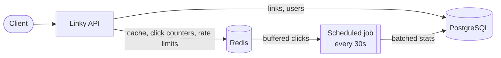
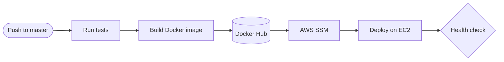

# Linky - URL Shortener

**Short links. Fast redirects. Smarter insights.**

Linky is a cloud-native URL shortener built with Java 25 and Spring Boot 4. It combines secure link management, Redis-backed redirects and asynchronous click analytics, and it deploys to AWS through a fully automated pipeline.

**[▶ Try the live API in Swagger UI](https://battery-bacteria-foe.ngrok-free.dev/swagger-ui/index.html)**

## Highlights

- **Fast redirects.** Links are served from a Redis cache, so popular links skip the database.
- **Analytics without the overhead.** Clicks are counted in Redis and flushed to PostgreSQL in batches every 30 seconds.
- **Secure.** RSA-signed JWTs, role-based access, owner-only access to links, and Redis-backed rate limiting.
- **Infrastructure as code.** VPC, EC2, RDS and IAM are defined in Terraform.
- **Commit to cloud.** GitHub Actions tests, builds and deploys to EC2 via AWS SSM, using short-lived OIDC credentials.

## Tech stack

| Area           | Technologies                                      |
|----------------|---------------------------------------------------|
| Backend        | Java 25, Spring Boot 4.1, Spring Security         |
| Data           | PostgreSQL 17, Redis 8, Liquibase                 |
| Testing        | JUnit 5, Mockito, Testcontainers                  |
| Infrastructure | AWS EC2, RDS, Terraform                           |
| Delivery       | Docker, GitHub Actions, AWS SSM                   |

## How it works



1. An authenticated user creates a short URL, and a random 7-character key is stored in PostgreSQL.
2. `GET /{shortKey}` resolves the key through Redis and redirects with `302`.
3. Each click increments a counter in Redis.
4. A scheduled job persists the counters to PostgreSQL in batches.

## API

| Method  | Endpoint                                   | Access        |
|---------|--------------------------------------------|---------------|
| `POST`  | `/api/v1/auth/register`, `/api/v1/auth/login` | Public     |
| `POST`  | `/api/v1/short-urls`                       | Authenticated |
| `GET`   | `/api/v1/short-urls`                       | Authenticated |
| `PATCH` | `/api/v1/short-urls/{shortKey}/deactivate` | Owner / admin |
| `GET`   | `/api/v1/links/{shortKey}/analytics`       | Owner / admin |
| `GET`   | `/{shortKey}`                              | Public        |

## Run locally

**Requirements:** Java 25, Docker, Docker Compose, and OpenSSL.

**1. Generate RSA keys for JWT authentication**

```bash
mkdir -p src/main/resources/keys
openssl genpkey -algorithm RSA -pkeyopt rsa_keygen_bits:2048 -out src/main/resources/keys/private_key.pem
openssl rsa -in src/main/resources/keys/private_key.pem -pubout -out src/main/resources/keys/public_key.pem
```

**2. Start PostgreSQL and Redis**

```bash
docker compose up -d postgres redis
```

**3. Configure environment variables**

Set the database and Redis credentials to match your local Docker Compose configuration.

**4. Start Linky**

```bash
./mvnw spring-boot:run
```

Once the application starts, explore the API at:

[Swagger UI — localhost:8080](http://localhost:8080/swagger-ui/index.html)

## CI/CD



1. **Test:** every push and pull request runs the unit and integration tests (Testcontainers).
2. **Build:** on `master`, a Docker image is built and pushed to Docker Hub, tagged with the commit SHA.
3. **Deploy:** GitHub Actions signs in to AWS with short-lived OIDC credentials (no stored AWS keys) and uses SSM to run the deploy script on EC2. No SSH needed.
4. **Verify:** the deployment succeeds only if the app passes its health check.

## Design trade-offs

- **Eventually consistent analytics.** Stats lag up to about 30 seconds, in exchange for fast redirects and far fewer database writes.
- **`302`, not `301`.** Browsers don't cache the redirect, so every click is counted.
- **Rate limiter fails open.** If Redis is down, requests go through rather than being rejected.
- **Single EC2 instance.** Deployments are health-checked but not rolled back automatically.
